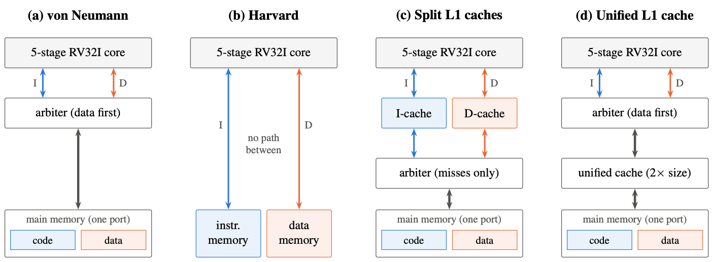
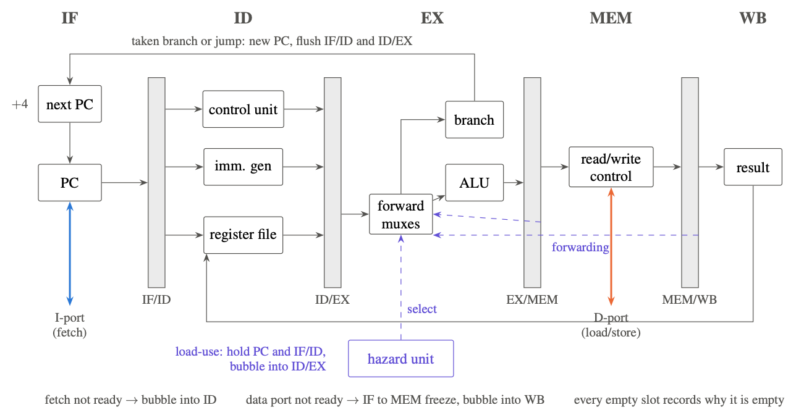
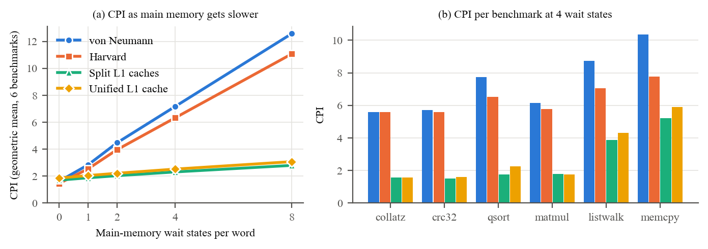
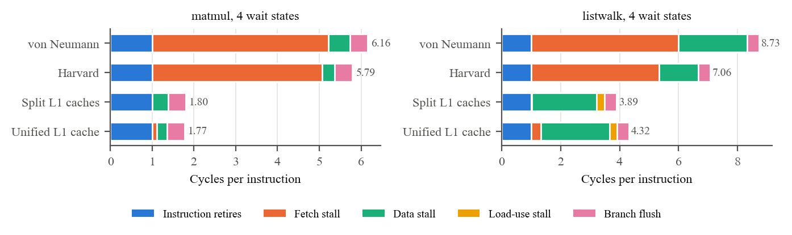
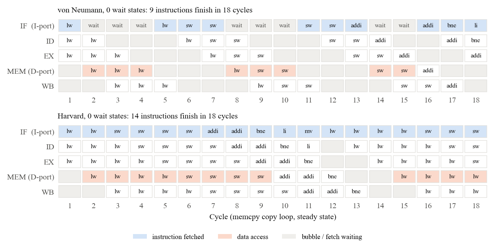
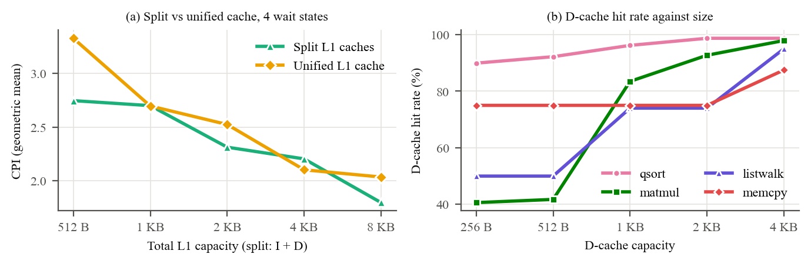

# Project 9: Instruction and Data Memory Hierarchy

Modern Computer Architecture, Section D.

A five-stage pipelined RV32I processor in Verilog, attached unchanged to four memory organisations: von Neumann, Harvard, split L1 caches over a shared main memory, and a unified L1 cache. Every run is checked instruction by instruction against a reference simulator, and the four systems are compared across memory latency and cache size.

| | |
|---|---|
| Report (IEEE format) | [report/Project9_IEEE_Report.pdf](report/Project9_IEEE_Report.pdf) |
| Prototype video (4 min) | [video/Project9_Demo.mp4](video/Project9_Demo.mp4) |
| All measured numbers | [results/summary.md](results/summary.md) |

## Team

| Member | Roll no. | Part of the project |
|---|---|---|
| Shourya Bafna | 2401010444 | Five-stage pipelined core, hazard unit, integration, report |
| Daksh Batra | 2401010138 | Program counter, register file, ALU, immediate generator, control unit |
| Aditya Bhardwaj | 2401020007 | Main memory with wait states, write-back cache, read/write control |
| Om Yadav | 2401010309 | Address decoder, arbiter, the four system top levels |
| Prajjwal Tripathi | 2401010331 | Assembler, reference simulator, test programs, verification and experiment scripts |

## The design

The same core, with an instruction port (I) and a data port (D), runs in all four systems:





- **Core:** IF, ID, EX, MEM, WB. Forwarding from EX/MEM and MEM/WB, one-cycle load-use stall, branches resolved in EX, FENCE.I. Both ports use a ready handshake, so memory can take any number of cycles. Every empty pipeline slot records why it is empty, which gives an exact breakdown of where cycles go.
- **Main memory:** configurable wait states per word (registered read, so it becomes block RAM on an FPGA).
- **Cache:** direct-mapped, 16-byte lines, write-back and write-allocate; flush for FENCE.I.
- **Memory map**, the same in every system: code at `0x0000_0000` (16 KB), data at `0x1000_0000` (16 KB), output port at `0x2000_0000`.

## Results

| Geometric-mean CPI over 6 benchmarks | von Neumann | Harvard | Split L1 caches | Unified L1 cache |
|---|---:|---:|---:|---:|
| 0 wait states | 1.61 | **1.45** | 1.70 | 1.86 |
| 4 wait states | 7.18 | 6.34 | **2.31** | 2.52 |
| 8 wait states | 12.57 | 11.07 | **2.80** | 3.07 |

- With fast memory, Harvard wins. Sharing one port costs von Neumann 11% on average and 44% on `memcpy`.
- With slow memory, split caches win: 3.1x faster than von Neumann at 4 wait states, 4.5x at 8.
- Split caches beat a unified cache of the same size, except where pooling capacity lets a working set fit.
- Without FENCE.I, self-modifying code runs the old instruction on the split-cache system. With FENCE.I it runs the new one.









## Verification

`python3 scripts/verify.py` runs, in about 20 seconds on a laptop:

- 18 assembler encoding checks and 5 unit testbenches (97 directed checks);
- 10 programs and 30 random programs on all 4 systems in 3 configurations (480 simulations). Each run's log of retired instructions, register writes, stores and outputs must match `scripts/iss.py`, a Python reference simulator.

Seven deliberately injected faults were all caught (report, Table III).

## Repository layout

```
rtl/        Verilog RTL (synthesizable)
tb/         unit testbenches and the system testbench
programs/   RV32I assembly: 6 benchmarks and 4 directed tests
scripts/    assembler, reference simulator, random programs, verify / experiments / plots / synthesis
results/    measured data (CSV + summary.md), pipeline traces, VCD waveforms, synthesis reports
report/     IEEE report: LaTeX source, figures, PDF
video/      prototype demonstration video
```

| File | What it is |
|---|---|
| `rtl/core.v` | five-stage pipelined RV32I core |
| `rtl/hazard_unit.v` | forwarding selects and load-use stall |
| `rtl/control_unit.v`, `rtl/imm_gen.v`, `rtl/regfile.v`, `rtl/alu.v`, `rtl/program_counter.v` | ID and EX building blocks |
| `rtl/main_memory.v` | memory with configurable wait states |
| `rtl/cache.v` | direct-mapped write-back cache |
| `rtl/rw_control.v` | byte strobes for stores, sign/zero extension for loads |
| `rtl/addr_decoder.v`, `rtl/mem_arbiter.v` | memory map and the shared-port arbiter |
| `rtl/vonneumann_top.v`, `rtl/harvard_top.v`, `rtl/modharvard_top.v`, `rtl/unicache_top.v` | the four systems |

## Running it

You need Python 3 and [Icarus Verilog](https://steveicarus.github.io/iverilog/):
macOS `brew install icarus-verilog`, Ubuntu `sudo apt install iverilog`, Windows: installer from <https://bleyer.org/icarus/>.

```bash
python3 scripts/verify.py
```

```bash
python3 scripts/experiments.py
```

```bash
pip install matplotlib
```

```bash
python3 scripts/plot_results.py
```

```bash
sh scripts/synth.sh
```

`verify.py` checks everything, and every line should say `PASS`. `experiments.py` runs the sweeps into `results/` (about a minute). `plot_results.py` redraws the figures. `synth.sh` needs [Yosys](https://yosyshq.net/yosys/).

**Waveforms.** Open any file in `results/waves/` in [GTKWave](https://gtkwave.sourceforge.net/) or at <https://app.surfer-project.org/>. Good signals are under `tb_system > dut > u_core`: `i_addr`, `i_ready`, `d_req`, `d_addr`, `d_ready`, `if_id_valid`, `mem_wb_valid`, `mem_wb_why`. `smc_test_split_cache.vcd` shows FENCE.I flushing both caches.

**One program by hand:**

```bash
python3 scripts/asm.py programs/qsort.s build/qsort
```

```bash
iverilog -g2005 -DTOP=modharvard_top -DSYS_SPLIT_CACHE -Ptb_system.MEM_WAIT=4 -s tb_system -o build/sim tb/tb_system.v rtl/*.v
```

```bash
vvp -n build/sim +CODE=build/qsort.code.hex +DATA=build/qsort.data.hex
```

The defines for the other systems are `-DTOP=vonneumann_top`, `-DTOP=harvard_top -DSYS_HARVARD` and `-DTOP=unicache_top -DSYS_UNIFIED_CACHE`. Add `+LOG` to print every retired instruction.

**Report:** build `report/Project9_IEEE_Report.tex` with Overleaf, `pdflatex` or `tectonic`.
